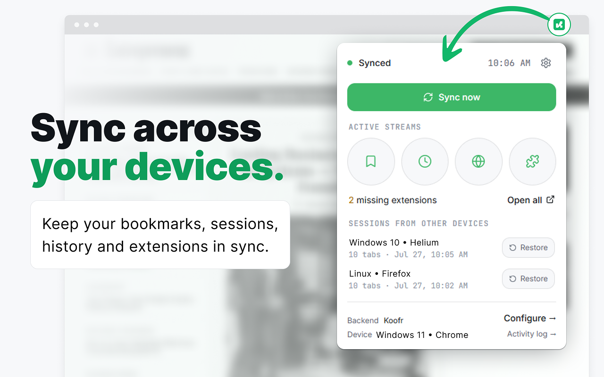

<p align="center">
  
</p>

<p align="center">
  <strong>Sync your browser to storage you own: no middleman, no account, no tracking.</strong>
</p>

<p align="center">
  Bookmarks · Open tabs · History · Extension list &nbsp;•&nbsp; Google Drive · GitHub · WebDAV &nbsp;•&nbsp; Optional end-to-end encryption
</p>

<p align="center">
  <a href="https://chromewebstore.google.com/detail/konode/mmlfiiimnpnjcjhhbldenpcmnibedkfa"></a>
  <a href="https://addons.mozilla.org/firefox/addon/konode/"></a>
  <a href="https://github.com/konabe-studio/konode/actions/workflows/ci.yml"></a>
  <a href="LICENSE"></a>
  <a href="https://github.com/konabe-studio/konode/stargazers"></a>
  
</p>

<p align="center">
  
</p>

---

Konode keeps your bookmarks, open tabs, history, and installed-extension list in sync
across your browsers, but instead of routing everything through a company's servers,
it writes to **storage you already own**: your Google Drive, a GitHub repository, or
any WebDAV server.

There's no Konode account to create and no Konode server to trust. Your data goes
straight from your browser to the place you picked, and your credentials never leave
your device. If you want, you can turn on end-to-end encryption so even your storage
provider can't read it.

## Why Konode

- **Your storage, your rules.** Pick Google Drive, GitHub, or WebDAV. Delete your data
  any time, straight from the provider.
- **No server, no telemetry.** Konode operates nothing in the middle. There's nothing
  to log, sell, or breach, because we never see your data.
- **Optional end-to-end encryption.** AES-256-GCM, chosen explicitly during setup. On
  or off, it's your call. Nothing is silently uploaded behind a hidden default.
- **Works across browsers.** Any Chromium browser, plus Firefox and Firefox-based browsers.
- **Light by design.** No background bloat, no third-party scripts, no external
  requests beyond your own storage backend.

## What you can sync

| Data | What it does |
|------|--------------|
| **Bookmarks** | Two-way sync that preserves your folder structure. Renames, moves and folder reorders travel too, and so do deletions, so no old bookmarks quietly come back. Keep any folder or bookmark out of the sync on a device, for example one another extension fills. |
| **Open tabs / sessions** | Save the current tab set and restore another device's session whenever you want, tab groups included (with their names and colours, if you allow it). Restoring opens only the tabs you don't already have. |
| **History** | Keep a synced, de-duplicated history list. *(On Firefox the original visit time is preserved; on Chrome the API can't set visit times, so restored entries show the sync moment.)* |
| **Installed extensions** | Sync the list and see at a glance which extensions are missing on the device you're on. |

When two devices disagree, you choose how it's resolved: newest change wins, always
prefer this device, always prefer the other, or resolve it yourself from the popup.

## Where your data goes

| Backend | Auth | Notes |
|---------|------|-------|
| **Google Drive** | One-time sign-in | Scoped to `drive.file`, so Konode only ever touches the files it creates. |
| **GitHub** | Fine-grained token | Point it at a single private repository. |
| **WebDAV** | Username + password | Presets fill in the address for Nextcloud / ownCloud, pCloud, Koofr, Fastmail, and Nutstore (坚果云), which works from mainland China where Google Drive can't be reached. **WebDAV (other)** takes Synology, kDrive, or any standard WebDAV server. |

## How Konode compares

**Pick by what you need.** Your browser's own sync is the least work if you use one
browser everywhere, and Firefox and Brave encrypt it end to end by default. floccus is the
one to look at if you want your bookmarks in a phone app, or synced to Nextcloud
Bookmarks, Linkwarden or Karakeep. Konode is for mixing browser families, Chromium and
Firefox, and syncing open tabs, history and the extension list along with your bookmarks,
to storage you already have.

| | Konode | floccus | Built-in sync |
|---|---|---|---|
| **What syncs** | Bookmarks, open tabs with their groups, history, extension list | Bookmarks, or open tabs (one per profile) | Bookmarks, tabs, history, passwords, settings and more |
| **Where it is stored** | Google Drive, GitHub, WebDAV | Nextcloud Bookmarks, WebDAV, Git, Google Drive, Dropbox, Linkwarden, Karakeep | The browser maker's servers |
| **Mixes Chromium and Firefox** | Yes | Yes | No, each syncs only with itself |
| **On phones** | Firefox for Android: open tabs and the extension list | Android and iOS apps, with your bookmarks inside the app | Everything, in the browser's own app |
| **End-to-end encryption** | Optional, on every backend | Optional, on WebDAV, Google Drive and Dropbox | Firefox and Brave always. Chrome only with a sync passphrase |
| **Account** | None beyond your storage | None beyond your storage | A Mozilla or Google account. Brave uses a sync code |
| **Around since** | 2026 | Years, with a much larger user base | As long as the browser |
| **Open source** | Yes, MPL-2.0 | Yes, MPL-2.0 | Clients open. Firefox's server too, Chrome's not |

A few details the cells are too small for. floccus syncs open tabs as an alternative to
bookmarks inside one sync profile, so doing both means setting up a second profile. Its
phone apps keep your bookmarks inside the app rather than in the phone's browser. Chrome's
sync passphrase covers everything except payment methods and addresses. xBrowserSync,
which this table used to list, has had no release since 2020. Checked November 2026 from
each project's own documentation and store pages.

**Running Konode alongside your browser's own sync.** You can, and people do, but it is
untested rather than known to work, so here is what to expect. The concern isn't that the
two will fight over your data. It's churn. The bookmarks API tells an extension that a
bookmark appeared, changed or was removed, and never who did it, so a bookmark that Chrome
Sync or Brave Sync has just brought in looks exactly like one you added yourself. Konode
publishes it, the other system carries it to its own devices, and the same change travels
twice. If both systems cover the same devices, you end up where you would have with either
one alone, just with more writes to your storage along the way. If they cover different
sets of devices, they bridge those sets together, deletions included, which may not be what
you had in mind. Picking one system for bookmarks is the simple answer.

## Privacy & security

- **No Konode servers exist.** Your data goes only to the backend you configure, and
  none of it is ever sent to us or to any third party.
- **Optional E2EE** (AES-256-GCM, PBKDF2-SHA256, 600k iterations): encrypt every
  payload before it leaves your browser. It's an explicit choice you make during
  onboarding. Default off, never silently enabled or disabled. Honest threat model:
  encrypted files sit on storage others can read, so a passphrase is guessable
  *offline*. The 600k-round derivation makes each guess slow, a new passphrase must
  be 12+ characters, and the generated key (recommended) is effectively unguessable.
- **Credentials stay local.** Access tokens, GitHub tokens, WebDAV passwords, and your
  encryption passphrase live only in the browser's own extension storage
  (`storage.local`) on your device and are
  never uploaded. (That store isn't encrypted at rest, so a fine-grained GitHub token
  and a dedicated WebDAV app password are good habits.)
- **Integrity checks.** Every payload carries a SHA-256 checksum that's verified on
  download before anything is imported.
- **Least privilege.** `history`, `tabs`, and `management` are requested only when you
  turn those data types on. The extension-list permission is read-only: Konode never
  installs or removes anything.

## Browser support

- **Chromium**: Chrome, Edge, Brave, Helium, ungoogled-chromium, and other Chromium
  browsers. Fully supported, and on the Chrome Web Store. A Microsoft Edge Add-ons
  listing, with the same package, is in review.
- **Firefox**: Firefox and Firefox-based browsers (e.g. Waterfox, Zen), from a
  dedicated build that ships on Firefox Add-ons. Same sync folder and same files as your
  Chromium browsers, so a Firefox install joins a group that is already running. In Zen,
  only the workspace in front shares its open tabs ([why](TROUBLESHOOTING.md#zen)).
- **Firefox for Android**: open tabs and the extension list, on GitHub or WebDAV storage.
  Firefox for Android gives extensions no bookmarks, history or Google sign-in
  ([details](TROUBLESHOOTING.md#firefox-for-android)).

> On non-Chrome Chromium browsers, Google Drive sign-in uses the OAuth PKCE flow
> (`launchWebAuthFlow`), so Drive sync works even where `chrome.identity.getAuthToken`
> isn't available.

## Translations

Konode speaks **English, Hungarian, German, Spanish, Italian, Russian and Chinese
(Simplified and Traditional)**, and follows your browser's language. Every screen is
translated: the popup, the setup wizard, and Settings. Dates and numbers follow your
browser's locale everywhere.

**Japanese**, **Estonian** and **Arabic** have been started. A language reaches a release
once it is complete, because a screen that is half translated reads worse than an English
one. Arabic also needs the pages laid out right to left, which comes with it.

Translations are edited on
[Hosted Weblate](https://hosted.weblate.org/projects/konode/). You don't need git, a
pull request, or any knowledge of the code to help. If your language is missing, ask
for it there and it will appear. The strings themselves live in this repository, under
`public/_locales/<lang>/messages.json`.

About half the strings carry a note explaining what they are and why they are worded the
way they are; a few of them make promises about not losing your data, and those have to be
translated literally. If a string's meaning isn't clear, leave it and ask. An
untranslated string falls back to English, which is safe.

## Install

- **Chrome / Brave / Helium / other Chromium browsers**: install from the
  **[Chrome Web Store](https://chromewebstore.google.com/detail/konode/mmlfiiimnpnjcjhhbldenpcmnibedkfa)**.
- **Microsoft Edge**: install from the Chrome Web Store link above for now (Edge asks once
  to allow extensions from other stores). A Microsoft Edge Add-ons listing is in review;
  it carries the same package as the Chrome Web Store, so the version is the same either
  way.
- **Firefox / Waterfox**: install from
  **[Firefox Add-ons](https://addons.mozilla.org/firefox/addon/konode/)**. On Firefox for
  Android, Konode syncs open tabs and the extension list (Firefox for Android gives
  extensions no bookmarks or history), on GitHub or WebDAV storage.

New to Konode? The **[Getting Started guide](GETTING_STARTED.md)** walks through setup
and connecting each backend.

## Build from source

```bash
npm install          # install dependencies
npm run type-check   # tsc --noEmit, should be clean
npm run build        # → dist/           (Chromium)
npm run build:firefox # → dist-firefox/  (Firefox)
```

**Chromium:** open `chrome://extensions`, enable Developer mode, click **Load
unpacked**, and select `dist/`. After any rebuild, click ↻ reload on the extension
(MV3 won't swap a running service worker automatically).

**Firefox:** open `about:debugging` → **This Firefox** → **Load Temporary Add-on** and
pick `dist-firefox/manifest.json`.

> Building the Google Drive backend yourself requires your own Google OAuth client
> (scope `drive.file`). GitHub and WebDAV need no setup beyond your own credentials.

## Verifying a build

`npm run checksum` prints a **build fingerprint**, a deterministic SHA-256 over the built
`dist/`. Check out a release tag and run:

```bash
npm ci && npm run build && npm run checksum
```

Two honest caveats. The release notes don't carry the fingerprint yet, so today this shows
you that the build reproduces, not that a particular download came from this tag. (GitHub
does publish its own SHA-256 digest next to each release asset, which covers the download
itself.) And the store builds can't match your hash: the zips for the Chrome Web Store,
Microsoft Edge Add-ons (the same file) and Firefox Add-ons are built with Konode's own
Google OAuth client compiled in, while the release zips and your own builds are not. It also assumes a comparable toolchain; the pinned
lockfile keeps dependencies identical.

## How it works

For each device and data type, Konode writes one JSON file (a `SyncPacket`) to a
`Konode` folder on your backend. Every sync pulls in each peer device's file, merges it
non-destructively, and pushes the result back. Bookmarks use tombstones so deletions
travel between devices without resurrecting old entries, and a safety cap stops a
corrupt deletion log from wiping your tree.

When E2EE is on, the payload is encrypted on the device and the checksum is still
computed over the plaintext, so identical content matches across devices without
revealing anything to the backend.

## When Konode syncs

Three things start a sync, and nothing else does:

- **A bookmark changes on this device.** The upload goes out about a second later, with a
  30-second backstop in case the browser suspends the extension mid-edit. Bookmarks only,
  and only while **Sync on change** is on (it is by default, under Settings → Device).
- **The scheduled pull**, every 60 seconds by default. This is how a device learns about
  its *peers'* changes, and it covers every data type you have enabled. Adjust it from 30
  to 600 seconds under **Settings → Device → Sync interval**, or turn it off with **Auto
  sync**.
- **You press Sync now** in the popup.

That's the whole list. History, open tabs and the extension list have no instant path, so
they travel on the scheduled pull. Starting the browser doesn't sync by itself either: it
re-arms the schedule, and the first pull arrives on the next tick.

Why the receiving side waits at all: Drive, GitHub and WebDAV are ordinary file storage
with no way to tell a device that something changed, so Konode has to go and look. 30
seconds is also the fastest a browser will run an extension's background timer, whichever
backend you pick, so that's the floor rather than a setting we're being cautious with.

## Why there's no password sync

Browser extensions **cannot** read the browser's native password store. That's an
intentional security boundary in the browser, not a Konode limitation. For passwords,
use a dedicated manager like [Bitwarden](https://bitwarden.com),
[Proton Pass](https://proton.me/pass), or self-hosted
[Vaultwarden](https://github.com/dani-garcia/vaultwarden).

## Roadmap

- **Shipped**: bookmarks / sessions / history / extension-list sync · Google Drive +
  GitHub + WebDAV · WebDAV provider presets, Nutstore (坚果云) included · multi-device
  merge · per-item conflict resolution · opt-in E2EE · Drive OAuth refresh (PKCE) ·
  cross-browser extension matching · bookmarks kept out of sync · tab groups in sessions ·
  **Chrome Web Store listing** · **Firefox Add-ons listing**, Firefox for Android included ·
  **translated interface** (English, Hungarian, German, Spanish, Italian, Russian, Chinese
  (Simplified and Traditional)).
- **In review**: the **Microsoft Edge Add-ons listing**, with the Chrome Web Store's package.
- **Next**: a held-back deletion that lists the bookmarks it holds
  ([#23](https://github.com/konabe-studio/konode/issues/23)) · a device list that says when
  each device was last active ([#10](https://github.com/konabe-studio/konode/issues/10)) ·
  a conflict card that shows what differs ([#35](https://github.com/konabe-studio/konode/issues/35)) ·
  the reading list ([#11](https://github.com/konabe-studio/konode/issues/11)) · more backends, cheapest sign-in first (Dropbox token and S3-compatible, then Dropbox OAuth
  and OneDrive) · faster history sync · more languages (Japanese, Estonian, Arabic).
- **Later**: right-to-left languages · incremental diff for very large bookmark trees ·
  diffs between restore points.

## Support & feedback

Something not working? Check **[Troubleshooting](TROUBLESHOOTING.md)** first. Still
stuck, or have an idea? **Open an issue**. It's the best way to reach us:
[github.com/konabe-studio/konode/issues](https://github.com/konabe-studio/konode/issues).

If Konode is useful to you and you'd like to support its development, you can
[buy me a coffee](https://buymeacoffee.com/konabe.studio) for a one-off tip, or give a
recurring amount on [Liberapay](https://liberapay.com/konabe). Entirely optional. Konode
is free and open source.

## License

See [LICENSE](LICENSE).

## How it's built

Konode is designed, tested and maintained by Kōnabe Studio. Much of the code is written with
an AI coding assistant (Claude Code), much as a project might work with a contractor: the
design decisions, the review before release and the testing stay with us. In practice:

- each release goes through a QA pass on real browsers and devices (Chromium browsers,
  Firefox, Firefox for Android), plus headless runs that play out multi-device scenarios;
- close to 900 automated tests run on every change;
- builds are reproducible, see [Verifying a build](#verifying-a-build);
- bug reports get an answer, and when the bug is ours, a fix with an explanation of what
  went wrong.

---

<p align="center"><sub>Konode is not affiliated with Google, GitHub, Mozilla, or any storage provider.</sub></p>
