# Konode features

What each part of Konode is for, when you would use it, and where to find it. New to
Konode? Start with the [Getting Started guide](../GETTING_STARTED.md). Something not
working? See [Troubleshooting](../TROUBLESHOOTING.md).

> **About the screenshots.** They show the version in development, so a few screens look
> newer than the 1.5.1 in the stores: Settings → Storage is a grid of tiles rather than a
> list, and the popup names each data type's state in words. Parts that are not in 1.5.1
> at all are marked **Coming in the next version**.

- [The popup](#the-popup)
- [What you can sync](#what-you-can-sync)
  - [Bookmarks](#bookmarks)
  - [Open tabs (Sessions)](#open-tabs-sessions)
  - [History](#history)
  - [Extension list](#extension-list)
- [Where your data goes](#where-your-data-goes)
- [End-to-end encryption](#end-to-end-encryption)
- [Keeping bookmarks out of sync](#keeping-bookmarks-out-of-sync)
- [When two devices disagree](#when-two-devices-disagree)
- [Restore points and the mass-deletion guard](#restore-points-and-the-mass-deletion-guard)
- [Your devices](#your-devices)
- [When Konode syncs](#when-konode-syncs)
- [Pausing sync](#pausing-sync) *(next version)*
- [Send to device](#send-to-device) *(next version)*
- [Activity log](#activity-log)
- [Backup and other settings](#backup-and-other-settings)

## The popup

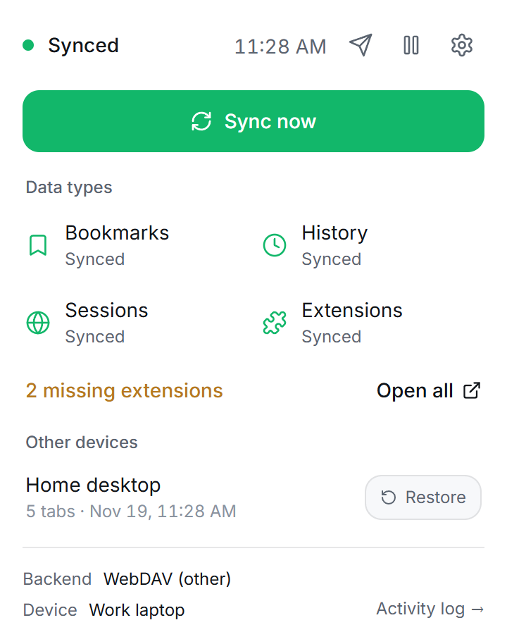

Click the Konode icon in your toolbar to see where things stand.

- **Status** at the top left: Ready, Syncing…, Synced, Error or Conflict, with the time of
  the last sync.
- **Sync now** syncs straight away, without waiting for the next scheduled pull.
- **Data types** lists the types you sync, each with its state: Synced, Not synced yet,
  Last sync failed, or Off.
- **Missing extensions** appears when another device has extensions this one does not.
  **Open all** opens their store pages in new tabs.
- **Other devices** lists the open tabs of each device that syncs them, with **Restore**.
- The icons at the top right open the [Send to device](#send-to-device) menu, [pause
  automatic sync](#pausing-sync), and open Settings. The first two are coming in the next
  version.
- **Activity log →** at the bottom opens [Settings → Activity](#activity-log).

The popup also carries notices that need you: a [conflict](#when-two-devices-disagree)
waiting for your choice, or a [deletion that was held back](#restore-points-and-the-mass-deletion-guard).

## What you can sync

Pick the data types under **Settings → Data Types**, or in the setup wizard. Bookmarks are on
by default. The other three are off until you turn them on, and turning one on is when the
browser asks for the permission it needs, so a type you never turn on is a permission
Konode never holds.

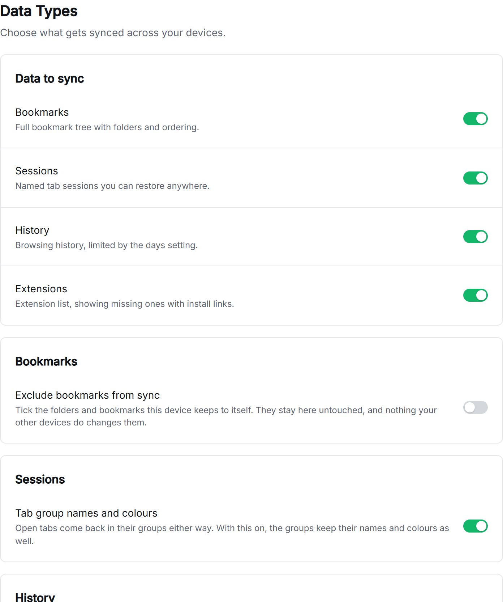

### Bookmarks

Your whole bookmark tree on every device, folders and order included. Use it when you want
the same bookmarks in every browser you use, including a mix of Chromium browsers and
Firefox.

- New bookmarks, renames, moves and folder reorders travel to your other devices.
- Deletions travel too, so a bookmark you deleted does not come back from a device that
  still had it.
- The first sync on a new device merges: bookmarks it already had are kept and combined with
  the rest.
- A folder can stay on one device only. See [Keeping bookmarks out of
  sync](#keeping-bookmarks-out-of-sync).

### Open tabs (Sessions)

Each device shares the tabs it has open. Use it to pick up on one computer where you left
off on another.

- In the popup, **Other devices** lists every device's tabs. **Restore** asks first, then
  opens them. A restore opens only the tabs you do not already have open, so restoring twice
  does not double them up.
- Tab groups come back as groups. With **Tab group names and colours** on (Settings → Data
  Types), they keep their names and colours too. Firefox has tab groups from version 138, and
  their names and colours from 139.
- A restore leaves pinned tabs out, because they are usually a device's own, such as mail or
  a calendar. Turn on **Restore pinned tabs** (Settings → Data Types) to open them too; they
  come back pinned. Whether a group was collapsed is not synced.

### History

The pages you visited, combined from your devices into one list without duplicates. Use it
when you want to find a page you opened on another computer.

- **Days to sync** sets how far back it goes: 7 to 365 days, 30 by default.
- Firefox keeps each page's original visit date. Chromium browsers give an extension no way
  to set it, so there a page from another device is dated when it arrived. Visit counts are
  not carried on either.

### Extension list

The names of the extensions you have installed, so you can see which ones a device is
missing. Use it when you set up a new computer.

- The popup shows how many are missing here, and **Open all** opens their store pages.
  Settings → Data Types lists them one by one with an Install or Find link.
- Konode never installs or removes an extension. The permission it asks for only reads the
  list.
- Between a Chromium browser and Firefox, extensions are matched by name and developer
  website, since the two stores use different IDs.

## Where your data goes

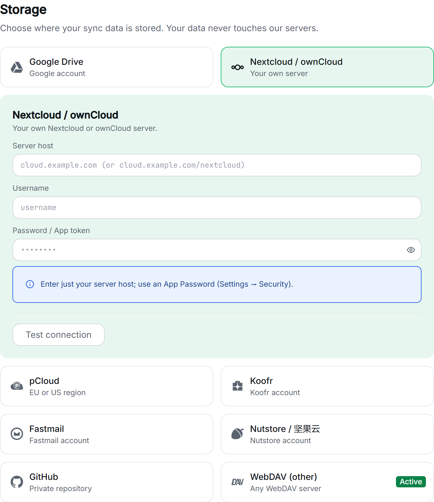

Konode writes to storage you already have, and to nothing else. Pick it under **Settings →
Storage**. All your devices use the same one.

| Storage | You need | Good for |
|---|---|---|
| **Google Drive** | A Google account. One sign-in. | The least setup. Konode sees only the files it created (`drive.file` scope). |
| **GitHub** | A private repository and a fine-grained token with Contents: Read and write. | A full history of every change, as commits. Public repositories are refused. |
| **Nextcloud / ownCloud** | Your server's host, your username and an app password. | Your own server. Konode builds the WebDAV address from the host. |
| **pCloud** | Your account region (EU or US). A paid pCloud plan. | pCloud users. |
| **Koofr** | Your Koofr email and a Koofr app password. | Koofr users. |
| **Fastmail** | Your Fastmail address and an app password with Files (WebDAV) access. | Fastmail users. |
| **Nutstore / 坚果云** | Your Nutstore email and a third-party app password. | Mainland China, where Google Drive cannot be reached. |
| **WebDAV (other)** | The full `https://` address of the server, a username and a password. | Synology, kDrive or any other WebDAV server. |

**Test connection** checks the details before you save. Konode connects to a WebDAV server
only over `https://`, or over `http://` to a server on the same computer, because WebDAV sends
your password with every request.

Konode keeps one file per device and data type in a `Konode` folder (`konode` on GitHub and
WebDAV). You can look at it, or delete it, with your provider's own tools.

## End-to-end encryption

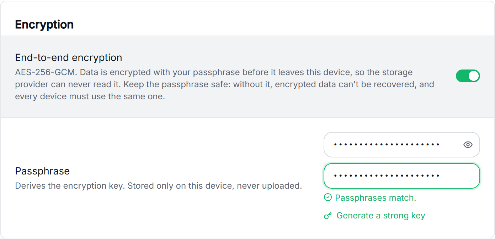

With encryption on, Konode encrypts your data on your device before it uploads it, so your
storage provider stores files it cannot read. Use it whenever anyone other than you could
see your storage.

- Turn it on in the setup wizard, or under **Settings → Storage → Encryption**. It is off
  until you choose it.
- Type a passphrase of at least 12 characters, or press **Generate a strong key**. Every
  device needs the same one.
- AES-256-GCM, with the key derived from your passphrase by PBKDF2-SHA256 over 600,000
  rounds. The passphrase stays on the device and is never uploaded.
- If a device's passphrase does not match the others, Konode tells you on that device
  instead of failing quietly.
- **There is no recovery.** Konode runs no server, so nobody can reset a lost passphrase.
  Keep it in a password manager.

## Keeping bookmarks out of sync

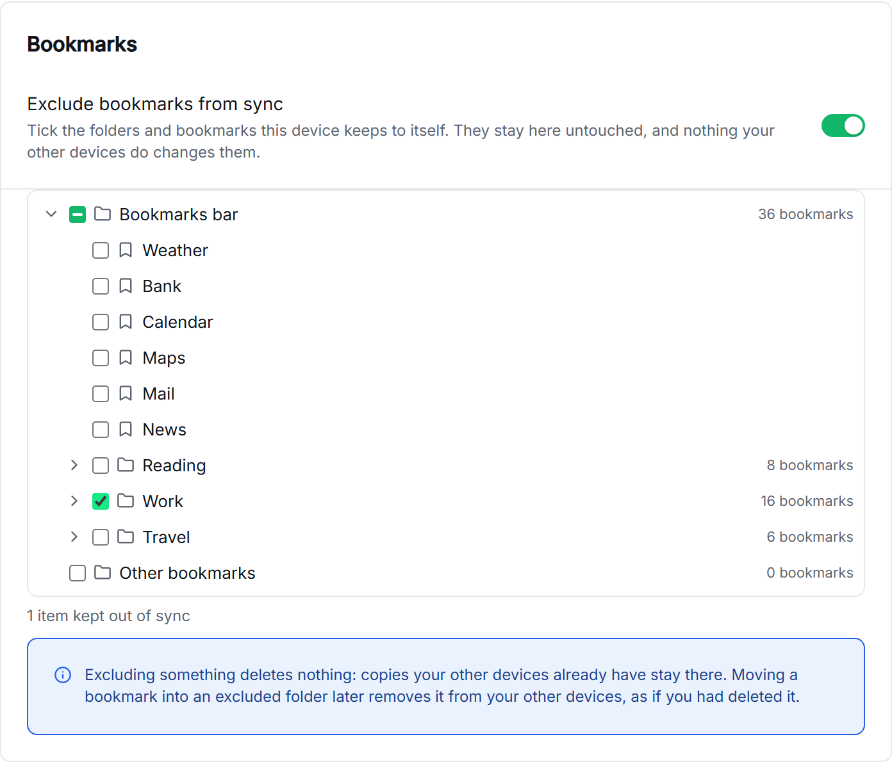

Tick any folder or bookmark to keep it on this device only. Use it for a folder another
extension fills, for work bookmarks you do not want at home, or for a very large folder you
never need elsewhere.

- Find it under **Settings → Data Types → Bookmarks → Exclude bookmarks from sync**, or
  under Bookmarks in the setup wizard.
- What you tick is never uploaded, and nothing your other devices do changes it. A ticked
  folder stays excluded when you rename it.
- Excluding deletes nothing: copies your other devices already have stay there.
- Moving a bookmark into an excluded folder removes it from your other devices, as deleting
  it would. Moving it back out brings it back to them.

## When two devices disagree

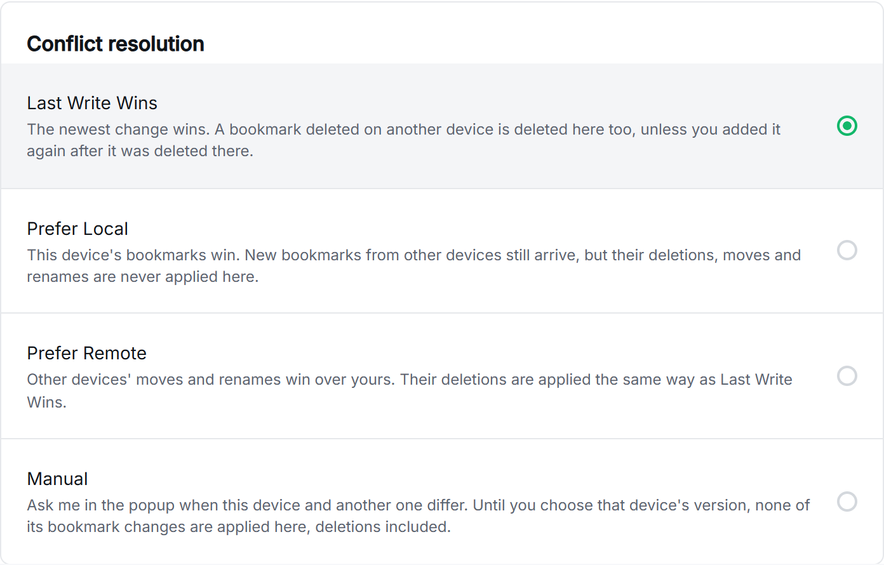

Choose under **Settings → Device → Conflict resolution** what happens when another device
changed the same bookmarks:

- **Last Write Wins** (the default): the newest change wins. A bookmark deleted on another
  device is deleted here too, unless you added it again after that.
- **Prefer Local**: this device's bookmarks win. New bookmarks from other devices still
  arrive, but their deletions, moves and renames are never applied here.
- **Prefer Remote**: other devices' moves and renames win over yours. Deletions work as in
  Last Write Wins.
- **Manual**: Konode asks you before it applies anything from a device whose bookmarks
  differ from yours. Until you choose, none of that device's bookmark changes reach this
  one, deletions included.

### Manual: choosing a version

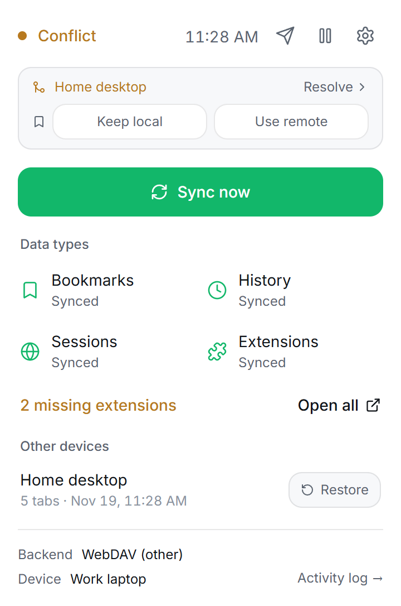

With Manual on, the popup shows a card for each device that differs. **Keep local** leaves
this device as it is. **Use remote** merges the other device's changes into this one.

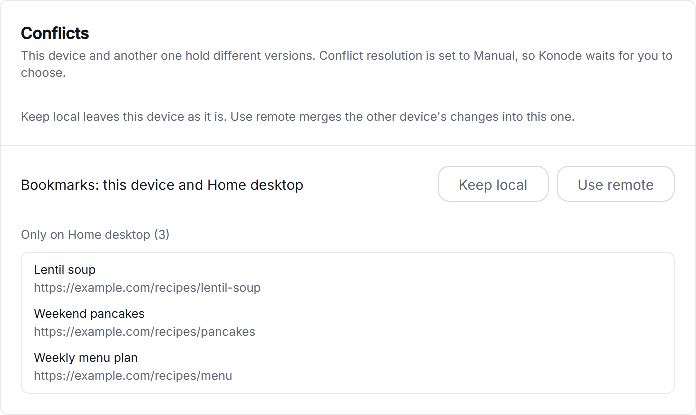

**Coming in the next version:** the card's **Resolve** link opens **Settings → Activity →
Conflicts**, which lists what differs before you choose: the bookmarks or pages only the
other device has, the ones only this device has, and how many sit in a different folder or
under a different title. Looking changes nothing on either device. In 1.5.1 the card names
the device but not what differs.

## Restore points and the mass-deletion guard

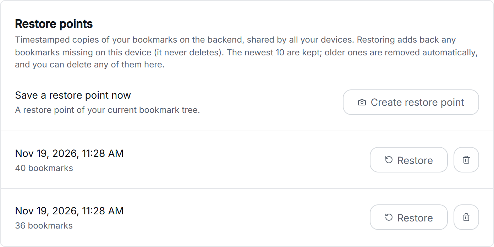

A restore point is a copy of your bookmark tree, kept in your storage where every device can
see it. Use one to undo a cleanup that went too far, on any of your devices.

- Find them under **Settings → Activity → Restore points**. **Create restore point** saves
  one now.
- **Restore** adds back the bookmarks missing on this device and puts them back where they
  were. It never deletes anything.
- The newest 10 are kept. You can delete any of them.

**The mass-deletion guard.** If another device asks to delete more than 60% of your
bookmarks within a day, Konode holds the deletion back, saves a restore point first, and
tells you in the popup. This protects you from a broken or confused device clearing every
browser at once, while ordinary cleanups still go through. Change the threshold under
**Settings → Device → Safety → Max bulk delete from a peer** (50 to 95%).

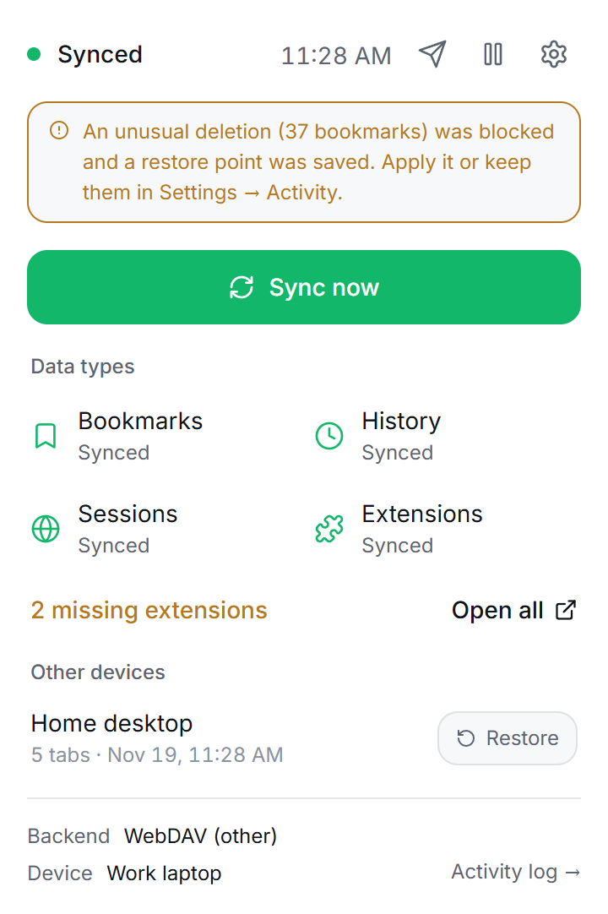

Then decide in **Settings → Activity → Blocked deletion**:

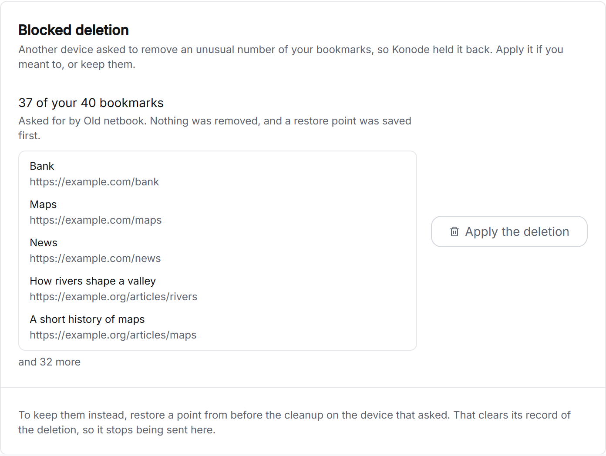

- **Apply the deletion** if you meant it.
- To keep the bookmarks, restore a point from before the cleanup on the device that asked.
  That clears its record of the deletion, so it stops being sent.

**Coming in the next version:** the card lists the first bookmarks the deletion would remove,
by title and address, so you can tell a cleanup you meant from one you never made. In 1.5.1
it gives the count and the device.

## Your devices

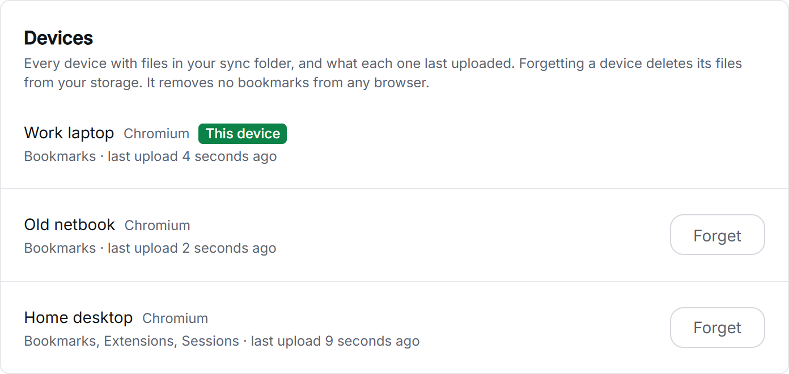

**Settings → Activity → Devices** lists every device with files in your storage and what each
one syncs. Use it to check that a new device has joined, or to clear out one you no longer
use.

- **Forget** deletes that device's files from your storage. It removes no bookmarks from any
  browser. A browser that is still running uploads itself again within a minute, so forget a
  device after you have uninstalled Konode there.
- Give each device a name you will recognize under **Settings → Device → Device name**.

**Coming in the next version:** each row says how long ago the device last uploaded ("last
upload 39 days ago") and which browser it is ("Brave (Chromium)", "Firefox (Gecko)"). A device
that has uploaded nothing for over 30 days is marked Inactive. Nothing happens to it on its
own.

## When Konode syncs

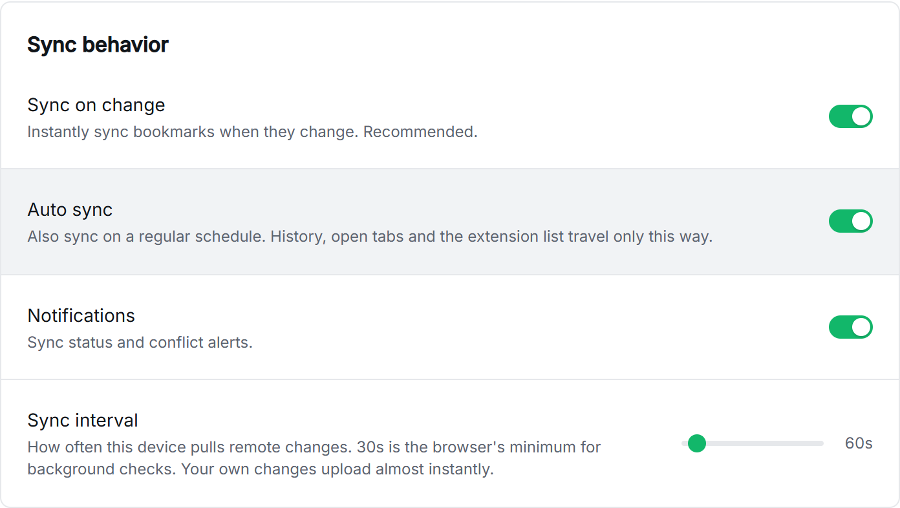

Three things start a sync, under **Settings → Device → Sync behavior**:

- **Sync on change**: a bookmark you add, edit or delete goes out about a second later.
  Bookmarks only.
- **Auto sync**: the scheduled pull, every **Sync interval** (60 seconds by default, 30 to
  600). This is how a device hears about other devices' changes, and how history, open tabs
  and the extension list travel.
- **Sync now** in the popup.

Your storage has no way to tell a device that something changed, so each device checks on a
schedule. 30 seconds is the fastest a browser runs an extension's background timer.

**Notifications** shows sync status and conflict alerts from the browser.

## Pausing sync

**Coming in the next version.**

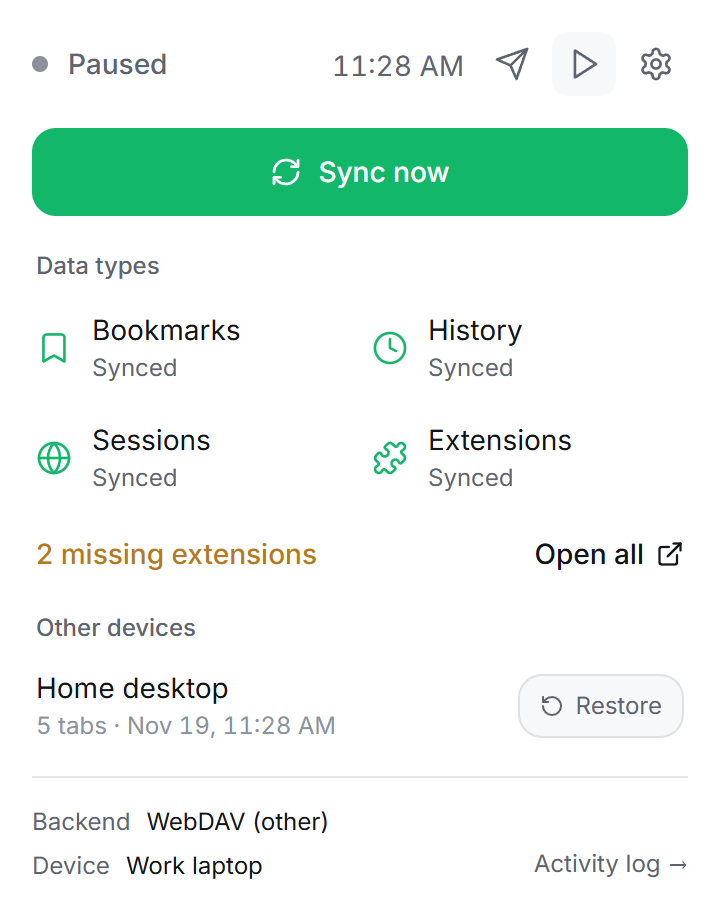

The pause icon at the top of the popup stops both automatic syncs, Sync on change and Auto
sync, until you resume. Use it while you reorganize a lot of bookmarks and want to finish
before your other devices see the result, or on a slow or metered connection.

- The status reads **Paused**, and the icon turns into a play button that resumes.
- **Sync now** still works while paused.
- Your edits are kept and go out with the next sync. Resuming syncs straight away.
- Settings → Device → Sync behavior says sync is paused, greys out the two switches and has a
  **Resume** button too. Your own Sync on change and Auto sync settings are left as they were.

## Send to device

**Coming in the next version.**

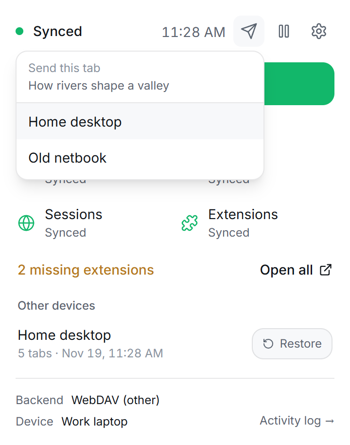

Send the page you are on to another of your devices. Use it to carry an article from your
computer to your phone, or a page from work to home, without bookmarking it.

- Right-click a page or a link and choose **Send to device**, then the device. In Firefox the
  entry is on a tab's own menu as well.
- Or press the paper-plane icon in the popup, which lists your devices for the page you are
  on.
- To keep your right-click menu clear, turn off **Send to device in the right-click menu**
  under Settings → Device → Sync behavior. The paper-plane icon in the popup stays.
- Firefox for Android receives tabs but cannot send them: it gives extensions no right-click
  menu, and its popup cannot see the page it was opened over.
- Konode has no server, so the tab travels through your storage and opens on the other device
  at its next sync, quietly, in a background tab. With Auto sync on that is within a minute or
  so. A device that is off opens it when it starts.
- A device is offered once it runs this version, and the right-click entry appears once one
  of your other devices can receive. With encryption on, a sent tab is encrypted
  like everything else, and a device that cannot read your encrypted data is not offered.
- A tab that is never picked up is dropped after 14 days.
- This adds two permissions that ask nothing at install: the right-click menu, and access to
  the tab you are on at the moment you click Konode or that menu entry.

## Activity log

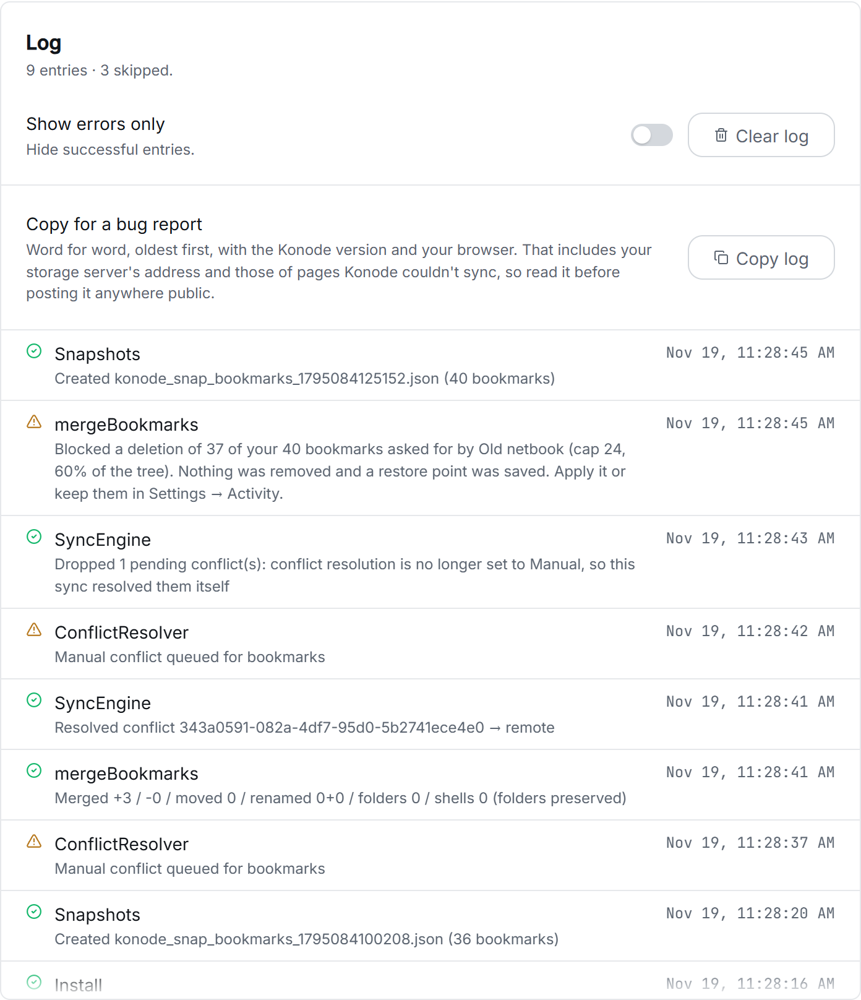

**Settings → Activity** shows what Konode did on this device: how much it transferred, how
many syncs it ran, and the last 200 log entries. All of it stays on the device.

- **Show errors only** hides the entries that went fine.
- **Copy log** puts the whole log on the clipboard, oldest first, with the Konode version and
  your browser at the top, ready to paste into a bug report. It is word for word, so it
  includes your storage server's address. Read it before you post it anywhere public.

## Backup and other settings

- **Export backup** (Settings → Advanced) downloads your bookmarks, history and extension list
  as a JSON file, with no storage needed. **Import backup** adds the bookmarks from such a
  file into a new folder, `Konode Import`.
- **Debug mode** (Settings → Advanced → Developer) writes more detail to the log. Turn it on
  when you are chasing a problem, and off when you are done.
- **Feedback** (Settings → Advanced) opens the GitHub issues, an email, or the store page to
  rate Konode. Nothing is sent unless you click.

Konode cannot sync passwords: browsers do not let extensions read their password store. Use a
password manager for those.

---

The screenshots are generated by a script, so they can be remade whenever the interface
changes. They use made-up bookmarks and devices.
